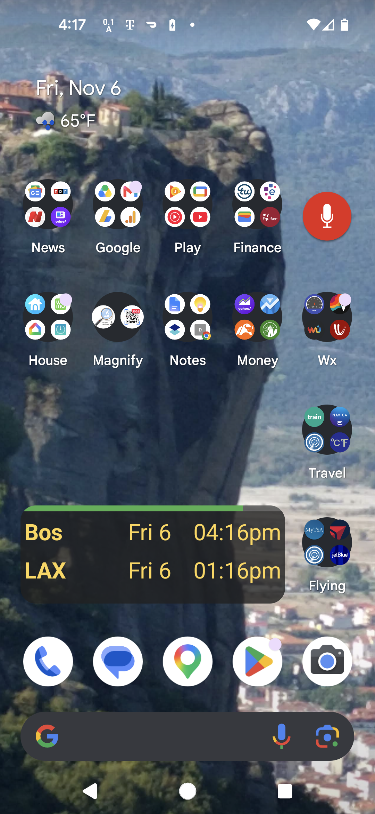
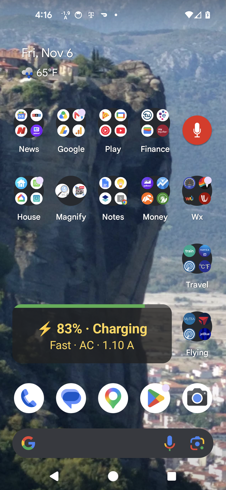
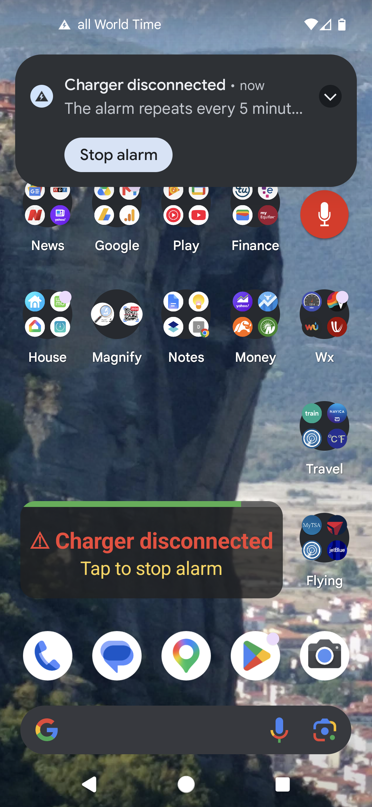
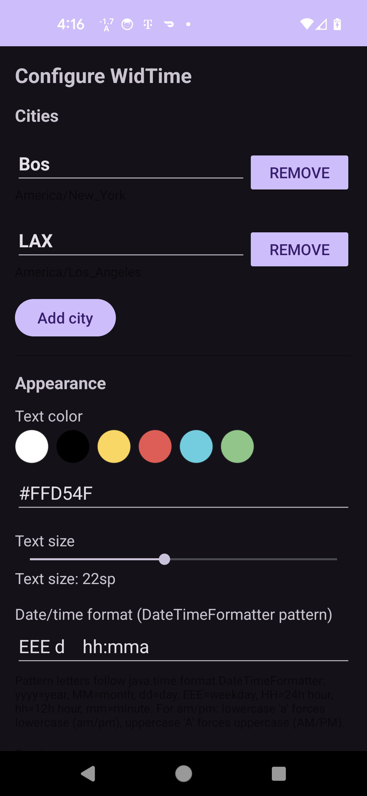
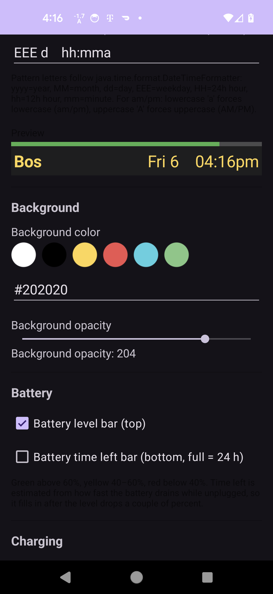
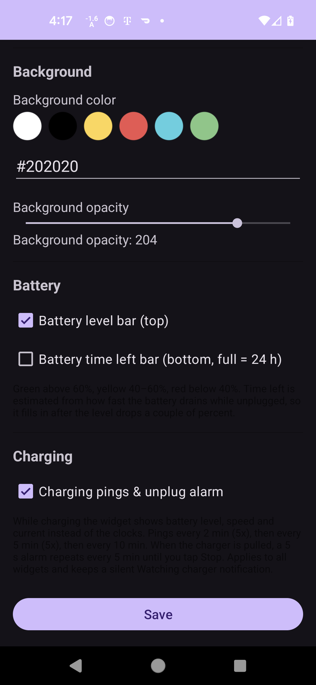

<table border="0">
  <tr>
    <td>
      <!-- VERSION -->v1.0<br>
      <!-- DATE -->06-Nov-2026<br>
      Android (Java)<br>
      <a href="https://github.com/landenlabs/all-WidTime">Repo</a>
    </td>
    <td>
      <a href="https://landenlabs.com">
        
      </a>
    </td>
  </tr>
</table>

# WidTime (all World Time)

An Android (Java) home screen **widget** that shows the current date and time for cities you
choose from around the world. Each widget has its own list of cities, colors, text size and
date/time format. Optional battery bars show the battery level and an estimate of the time
left. While the phone is charging the widget shows charging details instead, and an alarm
sounds if the charger is unplugged.

**By [LanDen Labs](https://github.com/landenlabs) (2026)**

---

### Screenshots

<table>
  <tr>
    <td><b>World clocks</b><br></td>
    <td><b>Charging</b><br></td>
    <td><b>Unplug alarm</b><br></td>
  </tr>
  <tr>
    <td><b>Settings: cities and appearance</b><br></td>
    <td><b>Settings: preview and background</b><br></td>
    <td><b>Settings: battery and charging</b><br></td>
  </tr>
</table>

---

### Features

**World clocks**
- Add as many cities as you like from a bundled offline list of about 100 major cities and
  their time zones. Search by city or country.
- If your city isn't listed, enter a name and a UTC offset (for example `+05:30`, `-08:00` or `Z`).
- Set the date/time format with a `java.time.format.DateTimeFormatter` pattern, for example
  `EEE d MMM, HH:mm`. Lowercase `a` prints am/pm in lowercase and uppercase `A` prints AM/PM.
- A live preview in the configuration screen shows the result before you save.

**Appearance**
- Text color and background color (pick a preset swatch or enter a hex value), text size and
  background opacity, set per widget.
- The widget can be resized horizontally and vertically.

**Battery**
- Optional battery level bar along the top: green above 60%, yellow from 40% to 60%, red below 40%.
- Optional time-left bar along the bottom, where a full bar is 24 hours. Android has no public
  "time until empty" API, so the app measures how fast the level drops while unplugged. The
  bar fills in after the level has dropped a couple of percent.

**Charging pings and unplug alarm** (optional)
- While charging, the widget shows battery level, charge speed (slow, fast, super fast),
  power source (AC, USB, wireless, dock) and current, in place of the clocks.
- A short ping plays every 2 minutes (5 times), then every 5 minutes (5 times), then every
  10 minutes while the phone charges. Pings follow the notification volume.
- When the charger is unplugged, the alarm sound plays for 5 seconds every 5 minutes until
  you tap **Stop** (in the notification, the alarm screen or the widget) or plug the charger
  back in.
- A small foreground service watches the charger, because Android 8 and later deliver
  charger connect and disconnect events only to running apps. It restarts after a reboot.

---

### Requirements

- Android 8.0 (API 26) or newer.
- No internet access is needed. The city list is built in.
- Permissions: notifications, exact alarms, foreground service, wake lock and start at boot,
  all used only by the charging pings and the unplug alarm.

### Setup

1. Long-press the home screen, choose **Widgets**, and add **all World Time**.
2. The configuration screen opens. Tap **Add city** to add cities.
3. Under **Appearance**, **Background**, **Battery** and **Charging**, choose the options you want.
4. Tap **Save**. To change the settings later, tap the widget.

### Building

```
./gradlew assembleDebug
```

The APK is named after the version, for example `WidTime-1.0-debug.apk`. Unit tests for the
charging and battery estimate logic run with:

```
./gradlew test
```

---

### License

```
Copyright 2026 Dennis Lang (LanDen Labs)

Licensed under the Apache License, Version 2.0 (the "License");
you may not use this file except in compliance with the License.
You may obtain a copy of the License at

 http://www.apache.org/licenses/LICENSE-2.0
Unless required by applicable law or agreed to in writing, software
distributed under the License is distributed on an "AS IS" BASIS,
WITHOUT WARRANTIES OR CONDITIONS OF ANY KIND, either express or implied.
See the License for the specific language governing permissions and
limitations under the License.
```
See [LICENSE](LICENSE) for the full license text.
